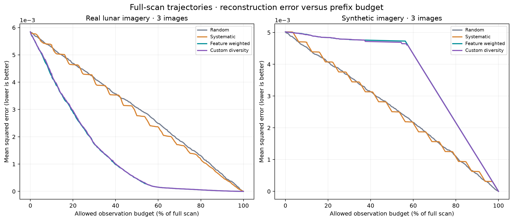

# LunaLens

## Intelligent Lunar Satellite Observation Planning

A runnable, CPU-only research prototype that asks **whether a satellite could
improve an image map with fewer high-resolution observations by choosing where
to look**. It includes real image processing, four executable observation
strategies, an exact-reveal simulator, a Streamlit research dashboard, automated
tests, and measured experiments. No GPU, model API key, or online service is
required to run the installed project.

This is an **AI-assisted engineering foundation** for a student's own work.
The supplied custom strategy is an editable example, not a claim that the
student independently designed or implemented this entire repository.

### What the executed experiment found

At **64 observations out of 256 regions**, the fixed feature-weighted strategy
had mean MSE **0.002315** on the three real lunar samples, compared with
**0.004444** for random selection: **47.90% lower mean MSE** on this small sample.
It needed **70.0 observations on average to halve initial MSE**, compared with
**131.6** for random selection. These are measurements from the bundled code,
not an assumed benefit of intelligent planning.

The result has important limits: feature selection was **26.42% worse than
random by MSE on the synthetic hidden-detail stress case**, and its mean MSE
across all three synthetic fixtures was **24.34% worse**. The custom diversity
example did not improve on the simpler feature baseline overall. On the
Giordano Bruno image, feature selection improved MSE but slightly reduced SSIM
relative to random and systematic selection. The report discusses each result.

Evidence: [measured tables](evidence/results/summary_by_image.csv),
[group summaries](evidence/results/summary_by_kind.csv),
[observation counts to quality targets](evidence/results/observations_to_targets_by_kind.csv),
and the [technical report](docs/TECHNICAL_REPORT.md).



## Start here

Use **Python 3.11 or newer**. The delivered build was executed on Python 3.12.14
under Linux. Dependencies in the lock file declare support for Python 3.11;
Windows, macOS, and a separate Python 3.11 runtime have not been executed here.

From the extracted `LunaLens` directory on macOS/Linux:

```bash
python3 -m venv .venv
source .venv/bin/activate
python -m pip install -r requirements-lock.txt
python -m pytest -q
python -m streamlit run app.py
```

Open the local URL printed by Streamlit, usually `http://localhost:8501`.
The first installation needs access to a Python package index, or a previously
prepared wheel cache. **The dashboard, tests, sample data, and experiments run
offline after dependencies are installed.** The archive does not bundle a
Python interpreter or third-party wheels.

On Windows, activation is optional; use the virtual environment's interpreter:

```powershell
py -3.11 -m venv .venv
.\.venv\Scripts\python -m pip install -r requirements-lock.txt
.\.venv\Scripts\python -m pytest -q
.\.venv\Scripts\python -m streamlit run app.py
```

`requirements.txt` contains supported dependency ranges. The lock file records
the exact versions used for the delivered evidence. Streamlit 1.66 or later is
required for the dashboard and its upload integration tests.

## A useful first demonstration

1. Select **LRO — Bouldery crater near Mare Australe**. Keep a 512-pixel image,
   32-pixel regions, downsample factor 4, and blur sigma 1.
2. In **Image Explorer**, compare the reference with the initially available
   map. Select the texture and information feature heatmaps.
3. In **Observation Planner**, choose **Weighted feature selection**, set the budget to **25%**
   (64 observations for these 256 regions), and run. The displayed map and
   metrics come from the actual simulator.
4. In **Results**, run the four-method comparison. Random selection uses the
   chosen number of seeds; all methods use the same image and budget. The
   dashboard default is three random repetitions; set five and seed zero to
   match the bundled experiment's random seeds 0–4.
5. Repeat on **SYNTHETIC — hidden detail** and explain why the ranking fails.
6. Use **Download run bundle (ZIP)** to export the selected simulation. It
   contains actual metrics, source/configuration metadata, exact float32 arrays,
   and PNG figures. The separate comparison bundle contains method metrics and
   16-bit PNG reconstructions.

The reference image is visible to the human researcher for inspection, but
the planner receives only permitted information. Changing the image, budget,
weights, seed, or degradation clears stale simulation output. Changing source
code requires restarting the Streamlit server; the app detects source changes
and prevents old and newly edited algorithms from being mixed.

## Reproduce the experiments

```bash
# Full benchmark: 6 images, 5 random seeds, 4 methods, 7 feature-drop ablations.
python -m experiments.run_experiments

# Additional executed-data diagnostics, quality-target counts, and gallery.
python -m experiments.diagnose_scores

# Print comparisons from a completed results directory.
python -m experiments.compare_algorithms
```

The default benchmark performs **48 full-scan runs and 42 ablation runs**.
Every full-scan run records all 257 states, including observation zero. The
delivered benchmark took about five minutes on the execution CPU; laptop
runtime depends on CPU and library builds. Results are written below
`evidence/results/` and figures below `evidence/figures/`. The numeric histories,
seed lists, image hashes, source hashes, exact dependency versions, command,
and completion status are recorded. See [validation](docs/VALIDATION.md).

For a short end-to-end check without overwriting the main evidence:

```bash
python -m experiments.run_experiments --limit 1 --max-dimension 128 --seeds 0 1 --output-dir evidence/local_runs/smoke
```

For a future custom policy that changes its decisions according to the
remaining budget, evaluate actual budget caps:

```bash
python -m experiments.run_experiments --independent-budgets --output-dir evidence/local_runs/independent
```

The shipped policies have budget-invariant prefixes under uniform costs, so
one full run correctly supplies their smaller-budget outcomes. A future
horizon-aware policy may not. The independent option reruns interior endpoints
at their actual caps; full-scan history curves remain labelled trajectories.
Read [the custom strategy guide](docs/CUSTOM_STRATEGY_GUIDE.md) before changing
that assumption. The default benchmark uses uniform observation costs; the
dashboard and simulator additionally support proportional-area cost on partial
boundary tiles.

## Offline data and attribution

Six 512×512 samples are included. The three real samples are central crops of
published LROC Narrow Angle Camera images from NASA's Lunar Reconnaissance
Orbiter, credited **NASA/GSFC/Arizona State University**:

| Sample | Source product | Source |
| --- | --- | --- |
| Bouldery crater near Mare Australe | PIA14421; NAC frame M150062296R | [NASA source](https://science.nasa.gov/photojournal/bouldery-crater-near-mare-australe/) |
| Giordano Bruno impact melt | PIA12932 | [NASA source](https://science.nasa.gov/photojournal/impact-melt-flows-on-giordano-bruno/) |
| The floor of Tycho | PIA12941 | [NASA source](https://science.nasa.gov/photojournal/the-floor-of-tycho/) |

These are **public outreach image derivatives, not calibrated or georeferenced
PDS products**. The source JPEGs, fixed crop coordinates, retrieval dates, source
URLs, and SHA-256 hashes are included in `data/manifest.json` and
`data/source_catalog.json`. Crops and preset weights were chosen before running
the benchmark. `data/ATTRIBUTION.md` explains the processing and credits.

The other samples are explicitly synthetic: `mixed` (seed 11), `rugged` (29),
and the adversarial `hidden_detail` fixture (47). They are made by
`src/synthetic.py`; none is presented as NASA imagery or a physical terrain model.

```bash
# Regenerate the PNGs from cached source JPEGs and procedural seeds, offline.
python -m experiments.prepare_data

# Optional: deliberately reacquire the public NASA source images.
python -m experiments.prepare_data --download
```

`--synthetic-only` is available for a clearly labelled synthetic dataset; it
replaces the sample manifest with synthetic entries. The unmodified archive
already includes all six samples, so no download is necessary.

## Implemented methods and the information boundary

| Method | Working policy |
| --- | --- |
| Random | Seeded uniform selection among affordable, unobserved regions. |
| Systematic | Deterministic row-major scan. |
| Feature weighted | Weighted initial-map descriptors divided by observation cost. |
| Custom diversity | Feature utility plus novelty relative to observed descriptors and spatial dispersion. |

Every planner receives an immutable `PlannerState`: initial map, current map
containing only already revealed pixels, normalized initial descriptors,
geometry/cost, observation status, remaining budget, and selected IDs.
Ground truth, reconstruction errors, and evaluation history are not part of
that interface. Leakage tests check detached arrays and counterfactual hidden
images. Python strategies remain trusted local code; this is an experimental
information boundary, not a sandbox against hostile introspection.

## Repository map

| Path | Purpose |
| --- | --- |
| `app.py` | Functional five-section Streamlit dashboard. |
| `src/image_loader.py`, `src/preprocessing.py` | Fixed-range loading, validation, Gaussian/coarse-grid degradation. |
| `src/segmentation.py`, `src/feature_extraction.py` | Region geometry, seven features, image-derived terrain proxies. |
| `src/observation_planner.py` | Immutable allowed state, strategy interface, three baselines. |
| `src/custom_strategy.py` | Isolated editable experimental policy. |
| `src/simulator.py`, `src/evaluation.py` | Exact reveals, cost enforcement, MAE/MSE/PSNR/SSIM histories. |
| `src/visualisation.py` | Reusable high-resolution Matplotlib figures. |
| `experiments/` | Executable data, benchmark, comparison, and diagnosis commands. |
| `tests/` | Mathematical, data, planner, leakage, budget, and UI integration tests. |
| `data/` | Source JPEGs, derived PNGs, synthetic fixtures, hashes, and credits. |
| `evidence/` | Genuine numeric results, logs, and figures from execution. |
| `docs/` | Technical report, architecture, custom guide, validation, and portfolio summary. |

## Make the project yours

Start with `src/custom_strategy.py` and
[CUSTOM_STRATEGY_GUIDE.md](docs/CUSTOM_STRATEGY_GUIDE.md). Decide what the objective
should reward, how exploration should be scheduled, and what a convincing test
set should contain. Record a hypothesis before running it. Use new images as
holdouts once you start tuning on these bundled examples.

Use [PORTFOLIO_SUMMARY.md](docs/PORTFOLIO_SUMMARY.md) as an editable record of what
you personally designed, implemented, tested, and learned. It deliberately
contains contribution placeholders rather than unsupported authorship claims.

## Scope

The prototype models a finite imaging budget with noiseless, aligned tile
reveals. It does not simulate orbital access, attitude slews, illumination
changes, compression, downlink queues, storage in bytes, or spacecraft hardware.
Image darkness, texture, and circle candidates are visual descriptors; they
cannot establish slope, elevation, hazards, or landing safety. The measured
three-image result is a useful experiment, not flight readiness or a claim of
general lunar-mapping performance. No NASA, UNSW, or BlueSat endorsement is implied.

