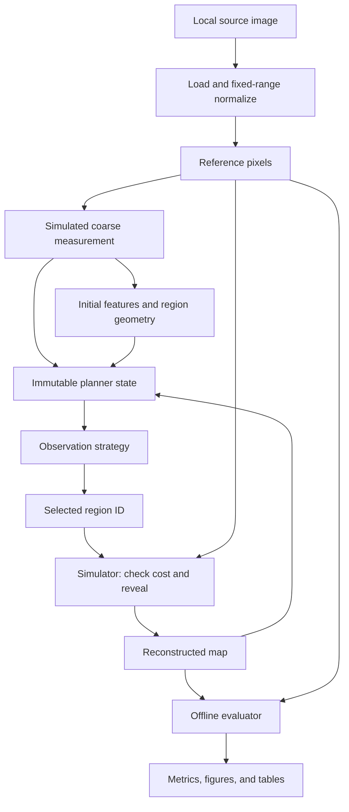

# LunaLens architecture

## Design intent

The simulator is the executable research instrument. The dashboard and
experiment runner call that same simulator, avoiding separate implementations
that could disagree. Image preprocessing, planning, and evaluation are distinct
modules, and the only planner-facing data structure is `PlannerState`.

## Information flow

There is no edge from reference pixels or evaluation errors to the planner.
The reconstructed map reaches the next planner state only after selected
regions have been revealed. Original full-resolution pixels remain confined
to the simulator's reveal operation and the evaluator. For optional diagnostic
analysis, true per-tile error is written after planning has completed; those
files are not read by any shipped policy.

## Modules and contracts

| Module | Responsibility | Key contract |
| --- | --- | --- |
| `image_loader.py` | Local PNG/JPEG/TIFF input, dtype normalization, sample manifest. | Returns finite, 2-D, detached float32 pixels in [0,1]. |
| `preprocessing.py` | Input validation and explicit degradation. | Gaussian blur, area averaging, bilinear upsampling; original shape retained. |
| `segmentation.py` | Complete row-major tiling. | Frozen `Region` geometry and cost; boundary regions retained. |
| `feature_extraction.py` | Initial-map descriptors and optional visual proxies. | Raw N×7 table; min-max normalization uses only initially available data. |
| `observation_planner.py` | Allowed state, eligibility, weights, baseline policies. | `scores(state)` and `choose_next(state, rng)`; ID-only output. |
| `custom_strategy.py` | Student-editable experimental rule. | Same strategy interface; current example uses utility, novelty, and distance. |
| `simulator.py` | Truth ownership, exact reveals, cost validation, histories. | Accepts `SimulationConfig`; returns one `SimulationResult`. |
| `evaluation.py` | Pure full-reference metric functions. | Does not import the simulator or expose metrics to a policy. |
| `visualisation.py` | Reusable PNG figures. | Takes actual arrays/tables, returns Matplotlib `Figure`. |
| `app.py` | Interactive research workflow and exports. | Calls the same simulator as the CLI; invalidates results after input changes. |
| `experiments/run_experiments.py` | Reproducible comparisons and ablations. | Uniform budgets, repeated random seeds, per-image aggregation, source hashes. |
| `experiments/diagnose_scores.py` | Completed-run diagnosis and quality-target counts. | Evaluation only; never a planner dependency. |

The package is named `src` to keep the requested layout straightforward. Execute
commands from the repository root. Sample data paths resolve from the module's
location rather than the shell working directory.

## Region identity and status

A `Region` has an ID, grid row/column, x/y origin, height, width, area, cost,
and NumPy slice coordinates. Arrays use `[y, x]` indexing; origin is the upper
left. IDs increase in row-major order and equal array indices in the standard
segmentation. Non-divisible image dimensions produce smaller boundary regions.

Feature vectors, priority scores, and observation status are kept in aligned
arrays, joined by region ID. They are not mutable fields on the frozen geometry.
This separates invariant geometry from changing acquisition state and allows
the dashboard to export a complete region table. Default cost is one per
region. Optional area cost is `height * width / region_size**2`.

## Planner state and extension boundary

`PlannerState` is a frozen, slotted dataclass with these fields:

| Field | Permitted meaning |
| --- | --- |
| `initial_map` | The degraded measurement, at display/reference-grid dimensions. |
| `current_map` | Initial map with only already selected regions replaced. |
| `features` | Normalized descriptors extracted from the initial map. |
| `regions` | Geometry and known observation costs. |
| `observed_mask` | Which region IDs have already been acquired. |
| `remaining_budget` | Available cost units. |
| `history` | Selected IDs in order; no errors or quality scores. |

Arrays are detached copies backed by immutable bytes. A strategy cannot turn
on their writable flags or change a retained earlier snapshot. The simulator
validates selection results independently of the policy, preventing repeated,
invalid, or unaffordable IDs from corrupting acquisition history.

This is an interface for **trusted local Python code**. It prevents accidental
research leakage through the supported API; it cannot stop a deliberately
hostile custom module from inspecting Python frames or reading reference files
directly. Do not add reference paths, evaluation metrics, diagnostic CSVs, or
unrevealed source patches to your strategy's inputs.

## Simulator life cycle

The simulator validates the reference and config, generates the initial
measurement, segments the image, extracts and normalizes initial features,
and instantiates the strategy. It records the zero-observation metrics before
entering a loop bounded by the number of regions. Each iteration receives a
new allowed snapshot, returns a region ID, checks affordability and repetition,
reveals that patch, and appends the next metric record.

The output includes final reconstruction, selected IDs, raw/normalized initial
features, initial scores, geometry, configuration, and the complete history.
Arrays in the result are immutable; histories are research output, not policy
input. `initial_map=` can inject a separately specified measurement for
controlled experiments, including counterfactual leakage tests.

## Numerical details that matter

Errors accumulate in float64 even though maps are float32. Constant feature
columns normalize to zero. Weights must be finite and nonnegative, with at
least one positive value, and are normalized to sum one. A zero budget buys
no positive-cost region. Area-cost remainder calculations use integer observed
pixel counts to avoid rejecting a final partial tile through cancellation
roundoff. Full coverage produces exactly zero MSE and infinite PSNR.

The benchmark's smaller-budget prefix optimization is valid for the shipped
uniform-cost policies. A custom rule depending on the planning horizon must
use `--independent-budgets`; actual cap endpoints and full-scan trajectories
have different interpretations. This condition is tested with both the shipped
policies and an intentionally horizon-aware counterexample.

## Dashboard state and provenance

Simulation settings and image content hashes form a fingerprint. Changes clear
stale runs; comparison repetition count additionally invalidates comparisons.
Replacing an upload with different bytes under the same filename is detected.
Current source hashes enter export metadata. The app retains a loaded-source
token and stops if algorithm source changes during a process, directing the
researcher to restart Streamlit. This avoids attributing cached Python code to
a freshly edited source file.

## Verification and limitations

The tests check mathematics, complete segmentation, loading/normalization,
budget enforcement, deterministic seeds, exact updates, counterfactual leakage,
aggregation, horizon-aware evaluation, and real dashboard actions/exports.
`docs/VALIDATION.md` records the final executed test and installation evidence.

Computational cost is dominated by full-image SSIM after every reveal, roughly
O(KHW), where K is observation count and H×W is map size. Initial feature
extraction is roughly O(HW), plus per-tile histograms and percentiles. Custom
novelty uses distances from N initial descriptors to t observed descriptors at
each step, so it grows approximately as O(NK²F), with F=7. At the bundled
N=256 this remains practical on a CPU. Large mosaics would need incremental
metric updates, caching of nearest distances, and a more scalable tiling/data
access design.

